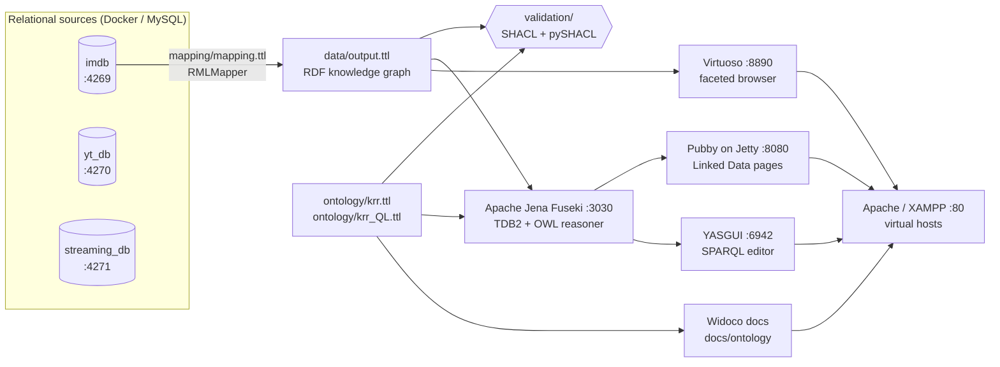

# Movies & TV Shows Knowledge Graph

A Knowledge Representation & Reasoning (KRR) project that turns relational movie
data (IMDb, YouTube trailer sentiments, Netflix / Prime Video / Disney+ catalogues)
into an **RDF knowledge graph** described by an **OWL ontology**, validated with
**SHACL**, and published as **Linked Data** with a SPARQL endpoint, an OWL reasoner,
a query UI and a faceted browser.

Namespace: `http://ceribouchetiflor.be/ontology#` (prefix `movi:`)
Resources: `http://ceribouchetiflor.be/resource/{Person|Show|Character|Genre}/{id}`

---

## Table of contents

- [Architecture](#architecture)
- [Repository layout](#repository-layout)
- [The ontology](#the-ontology)
- [From SQL to RDF](#from-sql-to-rdf)
- [Validation](#validation)
- [Publication](#publication)
- [Getting started](#getting-started)
- [Make targets](#make-targets)
- [Services and URLs](#services-and-urls)
- [Troubleshooting](#troubleshooting)
- [Credits](#credits)

---

## Architecture



1. **Sources** – three MySQL databases are built from raw CSV/TSV dumps
   (`data/*/`) by the SQL scripts run at container start-up.
2. **Mapping** – an RML mapping (`mapping/mapping.ttl`) queries the IMDb database
   with SQL and produces RDF that uses the project ontology.
3. **Validation** – the generated graph is checked against SHACL shapes,
   with RDFS inference over the ontology.
4. **Publication** – the graph is loaded into Fuseki (with and without OWL
   reasoning) and Virtuoso, then exposed through Pubby (dereferenceable URIs),
   YASGUI (SPARQL queries), Virtuoso's faceted browser and the Widoco ontology
   documentation, all behind Apache virtual hosts.

---

## Repository layout

```
.
├── ontology/               OWL ontology (source of truth)
│   ├── krr.ttl             full ontology (OWL 2 DL)
│   └── krr_QL.ttl          OWL 2 QL version used by the Fuseki reasoner
├── mapping/
│   └── mapping.ttl         RML mapping: MySQL (IMDb) -> RDF
├── data/
│   ├── imdb/               IMDb TSV samples + imdb.sql
│   ├── youtube/            YouTube trailer sentiments CSV + yt_db.sql
│   ├── streaming/          Netflix / Prime / Disney+ CSV + streaming_db.sql
│   └── output.ttl          generated knowledge graph
├── validation/
│   ├── shacl.ttl           SHACL shapes
│   └── validate.py         pySHACL validation script
├── docs/ontology/          Widoco HTML documentation (+ .htaccess for content negotiation)
├── fuseki/configuration/   Fuseki dataset definitions (FUSEKI_BASE = fuseki/)
├── pubby/                  Jetty base hosting the customised Pubby webapp
├── yasgui/index.html       SPARQL query UI with example queries
├── config/apache/httpd.conf  Apache virtual hosts / reverse proxy
├── scripts/setup.sh        downloads the third-party tools into tools/
├── docker-compose.yml      MySQL databases + phpMyAdmin
├── requirements.txt        Python dependencies (validation)
├── Makefile
└── tools/                  third-party tools (git-ignored, created by `make setup`)
```

---

## The ontology

The ontology models the movie domain around four core concepts.

| Class | Subclasses | Description |
|---|---|---|
| `movi:Show` | `Movie`, `ShortFilm`, `Serie`, `Episode` | Any title. A `ShortFilm` runs < 16 minutes, a `Movie` ≥ 16 minutes; `Serie`/`Episode` come from the episode table. |
| `movi:Person` | `Actor`, `Director`, `Writer`, `Composer`, `Editor` | People, typed by the job they did on a show. |
| `movi:Character` | | A role played by a person in a show. |
| `movi:Genre` | | Genre of a show. |

Main properties:

- **Work relations** – `workedFor` (Person → Show) with sub-properties `actedIn`,
  `directed`, `wrote`, `edited`, `composedFor`, `knownFor`; inverse `employed`
  with `directedBy`, `writtenBy`, `editedBy`.
- **Characters** – `played` / `playedBy` (Person ↔ Character), `appearsIn`
  (Character → Show).
- **Social** – `knows` (symmetric, irreflexive) and its sub-property `workedWith`.
- **Structure** – `hasGenre` (Show → Genre), `episodeOf` (Episode → Serie).
- **Data properties** – `name`, `BirthYear`, `DeathYear`, `startedOn`, `endedOn`,
  `runtimeMinutes`, `averageRating`, `numberOfVotes`, `isAdult`, `seasonNumber`,
  `episodeNumber`, `category`.

The full ontology (`krr.ttl`) also contains existential restrictions and
disjointness axioms (`Person`, `Show`, `Character`, `Genre` and `Profession`
are pairwise disjoint, as are `Movie`, `ShortFilm`, `Serie` and `Episode`). `krr_QL.ttl` is a reduced version that stays within the **OWL 2 QL**
profile so it can be used for query-time reasoning in Fuseki.

Human-readable documentation of `krr_QL.ttl` (English and French, with a
WebVOWL diagram) is in `docs/ontology/` and is served at
`http://ceribouchetiflor.be/ontology`. Regenerate it with `make docs`; Widoco
overwrites the hand-written sections (`docs/ontology/sections/abstract-*`,
`description-en`, `introduction-en`, `ns-*`), so restore them with
`git checkout -- docs/ontology/sections` afterwards if needed.

---

## From SQL to RDF

`mapping/mapping.ttl` is an [RML](https://rml.io/) mapping. Each `rr:TriplesMap`
runs an SQL query against the IMDb database (`jdbc:mysql://localhost:4269/ceribou-chetiflor`)
and builds resources from the results, for example:

| Triples map | Source query (simplified) | Produces |
|---|---|---|
| `<#Person>` | `person ⨝ known_for` | `Person/{n_const}` + `knownFor` |
| `<#Actor>`, `<#Director>`, `<#Writer>`, … | `person ⨝ principal / directed / wrote` | typed persons + work relations |
| `<#Show>`, `<#Movie>`, `<#ShortFilm>` | `title` filtered on runtime / episodes | `Show/{title_id}` |
| `<#Serie>`, `<#Episode>` | `title ⨝ episode` | series, episodes, `episodeOf` |
| `<#Character>` | distinct `principal.character_name` | `Character/{id}` + `playedBy`, `appearsIn` |
| `<#Genre>` | distinct `genre.genre_name` | `Genre/{id}` + `hasGenre` |

Generate the graph (MySQL must be running):

```bash
make db   # start the databases
make kg   # java -jar tools/rmlmapper-*.jar -m mapping/mapping.ttl -o data/output.ttl -s turtle
```

> Only the IMDb database is mapped to RDF. The YouTube and streaming databases
> are loaded alongside it and can be explored in phpMyAdmin.

---

## Validation

`validation/shacl.ttl` defines node shapes for `Character`, `Genre`, `Person`,
`Profession`, `Show` and `ShortFilm` (mandatory names, datatypes, value ranges,
disjointness via `sh:not`, …).

`validation/validate.py`:

1. loads `ontology/krr_QL.ttl` and materialises every `owl:inverseOf` axiom
   (swapped domains/ranges) into `ontology/krr_QL_expanded.ttl`;
2. validates `data/output.ttl` against the shapes with pySHACL and RDFS
   inference over the expanded ontology.

```bash
python3 -m venv .venv && . .venv/bin/activate
pip install -r requirements.txt
make validate      # -> "Conforms: True"
```

The OWL profile of the ontologies can be checked with ROBOT:

```bash
tools/robot validate-profile --profile DL --input ontology/krr.ttl
tools/robot validate-profile --profile QL --input ontology/krr_QL.ttl
```

---

## Publication

| Component | Role |
|---|---|
| **Apache Jena Fuseki 5.3** | SPARQL endpoint backed by TDB2. Two datasets: `ceribouchetiflorDS` (OWL Mini reasoner with OWL 2 QL options, schema = `ontology/krr_QL.ttl`) and `ceribouchetiflorDSNoReasoning` (raw data). Configuration in `fuseki/configuration/`. |
| **Pubby** (on Jetty 9.4) | Makes every resource URI dereferenceable: HTML pages for browsers, RDF for machines (`/page/…`, `/data/…`). Customised templates and config in `pubby/webapps/ROOT/`. |
| **YASGUI** | SPARQL editor (`yasgui/index.html`) with example queries, switchable between the two Fuseki datasets. |
| **Virtuoso 8.3** | Second triple store, used for its faceted browser (`/fct`). |
| **Widoco** | Generates the ontology documentation; `.htaccess` provides content negotiation (HTML, Turtle, RDF/XML, N-Triples, JSON-LD). |
| **Apache (XAMPP)** | Reverse proxy exposing everything under `ceribouchetiflor.be` virtual hosts (`config/apache/httpd.conf`). |

---

## Getting started

### Prerequisites

- **Linux** (XAMPP, Virtuoso binaries and `make run` use `/opt/lampp` and `sudo`)
- Java 11+
- Docker with Docker Compose
- Python 3.9+ (for validation)
- `curl`, `make`

### 1. Download the tools

```bash
make setup
```

This fetches Fuseki, Jetty, RMLMapper, ROBOT, Widoco and the XAMPP installer
into `tools/`. Virtuoso cannot be downloaded automatically: get the Virtuoso 8.3
Linux package from <https://virtuoso.openlinksw.com/download/>, extract it into
`tools/virtuoso/` and run its `./install.sh` there.

### 2. Install XAMPP

```bash
make install       # runs the XAMPP installer (as root) into /opt/lampp
```

### 3. Start the source databases

```bash
make db
```

phpMyAdmin is available at <http://localhost:8081>. Use server `imdb`, `yt_db`
or `streaming_db`, user `admin`, password `admin` (database `ceribou-chetiflor`).

### 4. Build and validate the graph (optional – `data/output.ttl` is committed)

```bash
make kg
make validate
```

### 5. Start the stack

```bash
make run
```

Then load `data/output.ttl` into both Fuseki datasets if they are empty, either
from the Fuseki UI (<http://localhost:3030>, *add data*) or with the Graph Store
Protocol:

```bash
for ds in ceribouchetiflorDS ceribouchetiflorDSNoReasoning; do
  curl -X POST -H 'Content-Type: text/turtle' --data-binary @data/output.ttl \
       "http://localhost:3030/$ds/data"
done
```

For the faceted browser, load the same file into Virtuoso (Conductor at
<http://localhost:8890/conductor> → *Linked Data* → *Quad Store Upload*).

### 6. Configure the host names

Add to `/etc/hosts` (use `127.0.0.1` locally, or the server IP found with
`ip addr`):

```
127.0.0.1 ceribouchetiflor.be
127.0.0.1 endpoint.ceribouchetiflor.be
127.0.0.1 faceted.ceribouchetiflor.be
```

### 7. Stop everything

```bash
make stop          # stops Apache, Fuseki, Pubby, YASGUI and Virtuoso
make db-stop       # stops the Docker databases
```

`make stop` only kills the project's own processes (it matches
`fuseki-server.jar`, Jetty's `start.jar` and `http.server 6942`).

---

## Make targets

| Target | Description |
|---|---|
| `make setup` | Download third-party tools into `tools/` |
| `make install` | Install XAMPP into `/opt/lampp` |
| `make db` / `make db-stop` | Start / stop the MySQL databases and phpMyAdmin |
| `make kg` | Generate `data/output.ttl` with RMLMapper |
| `make validate` | Run the SHACL validation |
| `make docs` | Regenerate the Widoco documentation from `ontology/krr_QL.ttl` |
| `make run` | Start Apache, Fuseki, Pubby, YASGUI and Virtuoso (logs in `logs/`) |
| `make stop` | Stop the services started by `make run` |

---

## Services and URLs

| URL | Service |
|---|---|
| <http://ceribouchetiflor.be/ontology> | Ontology documentation (content negotiation) |
| <http://ceribouchetiflor.be/dashboard> | Pubby home page |
| `http://ceribouchetiflor.be/resource/Person/nm0001908` | Any resource (303 → `/page/…` or `/data/…`) |
| <http://endpoint.ceribouchetiflor.be> | YASGUI SPARQL editor |
| <http://faceted.ceribouchetiflor.be/fct> | Virtuoso faceted browser |
| <http://localhost:3030> | Fuseki UI; endpoints `/ceribouchetiflorDS/query` and `/ceribouchetiflorDSNoReasoning/query` |
| <http://localhost:8080> | Pubby (direct) |
| <http://localhost:6942> | YASGUI (direct) |
| <http://localhost:8890> | Virtuoso (direct) |
| <http://localhost:8081> | phpMyAdmin |
| `localhost:4269` / `4270` / `4271` | MySQL: IMDb / YouTube / streaming (root password `root`) |

Example query (on `ceribouchetiflorDS`, the reasoner infers `Person` from the
sub-classes and property domains):

```sparql
PREFIX movi: <http://ceribouchetiflor.be/ontology#>

SELECT ?person ?name (COUNT(?show) AS ?shows)
WHERE {
  ?person a movi:Person ;
          movi:name ?name ;
          movi:workedFor ?show .
}
GROUP BY ?person ?name
ORDER BY DESC(?shows)
LIMIT 10
```

---

## Troubleshooting

- **First Pubby page returns HTTP 500 / Fuseki logs `Java heap space`** – the OWL
  reasoner computes its closure on the first query against `ceribouchetiflorDS`.
  Retry after it finishes, or give Fuseki more memory (add `-Xmx4g` to the
  Fuseki command in the `Makefile`).
- **`make kg` cannot connect** – the IMDb container must be up (`make db`) and
  listening on port `4269`; credentials are in `mapping/mapping.ttl`.
- **Host names do not resolve** – check `/etc/hosts` and that Apache was
  restarted by `make run` (`sudo /opt/lampp/lampp status`).
- **Port already in use** – the stack uses 80, 3030, 6942, 8080, 8081, 8890 and
  4269–4271.

---

## Credits

- Docker set-up adapted from [chrdebru/docker-lamp](https://github.com/chrdebru/docker-lamp).
- Datasets: [IMDb non-commercial datasets](https://developer.imdb.com/non-commercial-datasets/)
  (10 000-row samples), Netflix / Amazon Prime / Disney+ title catalogues and a
  YouTube movie-trailer sentiment dataset.
- Tools: [Apache Jena Fuseki](https://jena.apache.org/documentation/fuseki2/),
  [RMLMapper](https://github.com/RMLio/rmlmapper-java),
  [pySHACL](https://github.com/RDFLib/pySHACL), [ROBOT](https://robot.obolibrary.org/),
  [Widoco](https://github.com/dgarijo/Widoco), [Pubby](https://github.com/cygri/pubby),
  [YASGUI](https://github.com/TriplyDB/Yasgui),
  [OpenLink Virtuoso](https://virtuoso.openlinksw.com/).
